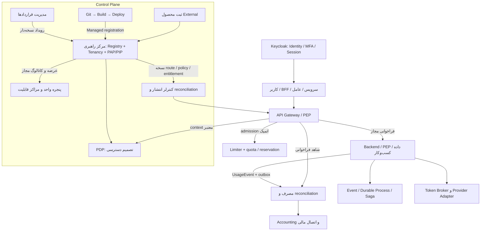
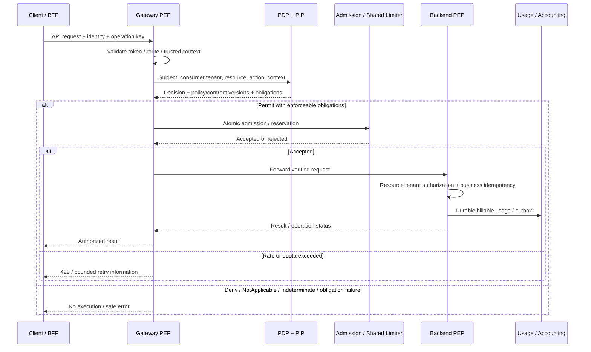

# سند نهایی معماری پلتفرم و مرکز راهبری فن‌آسا

نسخهٔ مرجع: ۱٫۰ — ۱۰ اکتبر ۲۰۲۶

**Fanasa Platform Control Center / مرکز راهبری پلتفرم فن‌آسا، مرجع راهبری تولید، عرضه، مصرف و توسعهٔ محصولات در بستر مشترک فن‌آسا است.** شرکت‌ها و تیم‌ها مالک محصول خود می‌مانند. فن‌آسا هویت، قابلیت‌های مشترک، منابع، مسیر توسعه و استقرار، دسترسی، مشاهده‌پذیری و اقتصاد مصرف را به هم متصل می‌کند.

جریان اصلی این معماری چنین است:

**قرارداد معتبر → entitlement و سیاست نسخه‌دار → تصمیم XACML → اعمال در Gateway و محصول → مصرف قابل حسابرسی → قیمت‌گذاری و تسویه.**

این سند طراحی مرجع نهایی برای توسعه است. وضعیت پیاده‌سازی هر بخش در بخش ۲ مشخص شده است؛ نهایی‌شدن طراحی به معنای فعال‌بودن همهٔ اجزا در تولید نیست. برنامهٔ وابسته در [پلن رشد و توسعه](E:/SJVS/Projects/Neo/docs/fanasa-platform-control-center/GROWTH-AND-DEVELOPMENT-PLAN.md) آمده است.

## ۱. مبنا و دامنهٔ تصمیم

درخواست مستقیم کاربر در ۱۰ اکتبر، تدوین سند معماری و پلن توسعه را مجاز و لازم کرد. کاربر روشن کرد که اصطلاح مورد بحث **XACML از OASIS** بوده و پارامترهای قرارداد باید در rule، role، TPS و سایر محدودیت‌های مصرف اثر بگذارند. API Gateway نیز جزء صریح معماری است. این توضیح، مرجع تفسیر اصطلاح است؛ فرضیهٔ قبلی Zachman مبنای این طراحی نیست.

دانش منتقل‌شده از چت قبلی، شش گزارش متن جلسه، اسناد معماری NeoCluster و کد فعلی برای حفظ پوشش بحث‌ها استفاده شده‌اند. انتساب تمام جملات جلسه به گوینده یا تیم مشخص، شنیدن کامل صوت و تصویب همهٔ پیشنهادهای جلسه ادعا نمی‌شود. تصمیم‌های طراحی این سند بر درخواست فعلی، نیازهای پایدار کاربر و تحلیل معماری متکی‌اند؛ پیشنهادهای ابزار و تجربهٔ تیم دیگر ورودی ارزیابی‌اند.

دامنهٔ سند شامل مرکز راهبری، Gateway، هویت و سازمان، ثبت و عرضهٔ محصولات، قرارداد، دسترسی، توسعه و استقرار، ارتباطات و فرایند، مصرف و اقتصاد، منابع و AI و رشد اکوسیستم است. نام فنی `Fanasa.AccessManagement.Web` و clientهای موجود تا مهاجرت مستقل برای سازگاری حفظ می‌شوند.

## ۲. مبنای واقعی پیاده‌سازی

| بخش | مبنای موجود در کد یا شاهد ثبت‌شده | کار باقی‌مانده |
| --- | --- | --- |
| هویت | Keycloak مرکزی و realm `fanasa`؛ اتصال مستقیم OIDC محصولات | پذیرش هر محصول و API با client و audience مستقل |
| مرکز راهبری | میزبان AccessManagement؛ ماژول‌های Tenancy، Organization، Accounting، Governance و Audit | یکپارچگی مسیر عملیاتی و انتشار نسخهٔ مرجع |
| ماندگاری | `PersistentAccessManagement` و Fabric SQLite فعال؛ رجیستری مرکزی ذخیره‌ساز مستقل دارد | dispatcher بیرونی، بازیابی عملیاتی و آماده‌سازی چندمیزبان |
| قرارداد و دسترسی | entitlement و receipt پایدار؛ کنترل قرارداد/عرضه/عضویت/اعتبار و سقف seat در بررسی تاریخی سورس توسعه‌یافتهٔ `8f13` مشاهده شده بود؛ دسترسی فعلی به دو فایل شاهد آن برقرار نیست | تطبیق source/artifact؛ policy، role binding، TPS، burst و quota نسخه‌دار از قرارداد |
| سیاست XACML | پروفایل typed محدود، نگارش، انتشار مستقل و شبیه‌سازی چهار تصمیم | اتصال زندهٔ PDP/PEP، چرخهٔ اجرای سیاست و انطباق پروفایل منتخب |
| پنجره واحد | مستند انتشار توسعهٔ ۱۰ اکتبر: SSO، سازمان مجاز و رد سازمان نامجاز موفق؛ سرویس کاتالوگ متصل است | کاتالوگ حساب واقعی خالی؛ پذیرش بازکردن سامانه، کاربر بدون grant و SaaS بین دو tenant |
| API Gateway | Apache APISIX مقصد طرح موجود؛ نشانی و مسیر مهاجرت مستند است | نصب، کنترلر، policy adapter، شمارندهٔ مشترک، cutover و پذیرش ترافیک |
| اتصال فرایند | طرح System/Process/Experience API، event، Saga و idempotency و UI پیش‌نویس وجود دارد | engine/store/worker و اجرای واقعی؛ UI شاهد اجرای فرایند نیست |
| اقتصاد مصرف | Accounting تراکنشی، payg/postpaid و مصرف idempotent در سورس | metering سراسری، reconciliation، سهم تولیدکننده، مصرف دیررس و پذیرش مالی عملیاتی |
| منابع و AI | طراحی provider adapter و Token Broker؛ ابزارهای AI در گزارش‌ها مطرح‌اند | مسیر end-to-end اعتبار، مدل/GPU، سهمیه و مصرف تأییدشده |

در بررسی پیشین، دو نسخهٔ سورس مرکز هم‌سطح نبودند. پوشهٔ `E:/SJVS/Projects/Neo`، `PlatformService/platform.registry` داشت؛ در snapshot تاریخی worktree توسعه‌یافتهٔ `8f13`، `PlatformCatalog/platform.catalog`، `application-tenants`، عرضه/مصرف و سرویس قرارداد نیز مشاهده شده بود. پذیرش ثبت‌شدهٔ پورتال توسعه با قرارداد توسعه‌یافته انجام شده است. در بررسی نهایی ارجاع‌ها، دو فایل شاهد `ApplicationTenancy.cs` و `ContractIntegrationApi.cs` در مسیرهای تاریخی در دسترس نبودند؛ این شواهد، تضمین موجودبودن همان سورس در checkout فعلی نیستند. برنامه از تطبیق source، artifact و پیکربندی انتشار شروع می‌شود؛ هیچ پوشه‌ای کورکورانه جای دیگری کپی نمی‌شود.

SQLite فعال را با adapter آزمایشی SQL یکسان نمی‌گیریم. وجود SQL Server روی VPS، فعال‌بودن adapter را ثابت نمی‌کند. همچنین تراکنش مشترک Fabric، همهٔ تغییرات رجیستری مستقل و سامانهٔ قرارداد را اتمی نمی‌کند؛ همگام‌سازی میان آن‌ها به event و reconciliation نیاز دارد.

## ۳. لایه‌ها و مالکیت

| لایه | مسئولیت مرجع | خروجی برای محصول |
| --- | --- | --- |
| راهبری | مرکز راهبری: استاندارد، ثبت، سازمان، عرضه، entitlement، سیاست و audit | محصول و مصرف‌کنندهٔ شناخته‌شده با قرارداد اتصال و مصرف |
| هویت و سازمان | Keycloak برای هویت؛ مرکز برای tenant، عضویت، چارت، سمت و انتصاب | principal معتبر و رابطهٔ سازمانی قابل کنترل |
| قابلیت‌های مشترک | قابلیت‌ها و سرویس‌های ثبت‌شده در ۱۴ مرکز رسمی | API و ابزار نسخه‌دار برای پیام، فایل، جست‌وجو، فرایند، داده و AI |
| منابع و providerها | adapterهای منابع، vault، ظرفیت و Token Broker | دسترسی محدود به زیرساخت، اعتبار، مدل، GPU و سرویس عرضه‌کننده |
| تجربهٔ توسعه‌دهنده | workspace، template، Neo، مستندات، Skills/MCP و مسیر Git تا دپلوی | ساخت محصول توسط تیم تخصصی یا Generalist با کنترل انتشار |
| اجرای محصول | Gateway، backendها، event backbone و اجرای durable فرایند | عملیات مجاز، ایزوله، قابل ردگیری و قابل بازیابی |
| عملیات و اقتصاد | عملیات بستر، Accounting و اتصال مالی/قرارداد | SLA، مصرف، هزینه، صورتحساب، درآمد و ظرفیت قابل اندازه‌گیری |

وظیفهٔ راهبردی مرکز، اتصال سبد محصولات شرکت‌ها و مراکز قابلیت به اولویت توسعه، ظرفیت، ریسک و اقتصاد مصرف است. مدیر محصول پلتفرم و مالکان شرکت‌ها، نقشهٔ راه، نیازهای مشترک، معیار ادامه/توقف سرمایه‌گذاری و تعهد خدمت را با شواهد مصرف و هزینه بازبینی می‌کنند. پنل مرکز، وضعیت مطلوب و واقعی انتشار، پوشش سیاست، سلامت اتصال، مصرف، هزینه و پیشرفت پذیرش را برای همین تصمیم‌ها نشان می‌دهد. این اطلاعات مجوز فنی جدید ایجاد نمی‌کنند؛ اختیار هر تصمیم و اقدام همچنان به نقش و دامنهٔ معتبر وابسته است.

۱۴ مرکز رسمی: کاروان، ابرگان، کاوان، پیوند، دانا، بنیان، ابر فن‌آسا، آسمان، کرانه، رایان، دژان، آیین، دیده‌بان و ترازو. هر محصول دقیقاً یک مرکز اصلی ثبت‌شده دارد؛ وابستگی به قابلیت‌های دیگر مجاز است. نام asset معادل audience نیست. هویت و دارایی رسمی از [برندبوک فن‌آسا](https://fanasa.net/fa/brand) اخذ می‌شود؛ انتساب جدید مرکز یا ساخت لوگوی جایگزین از نام ابزار استنتاج نمی‌شود.

### مرجع حقیقت دامنه‌ها

| دامنه | مالک و مرز داده |
| --- | --- |
| هویت | Keycloak: `sub`، رمز، MFA، نشست و client credential؛ محصول مخزن رمز موازی ندارد |
| ثبت محصول | مرکز راهبری و PlatformRegistry: کلید ثابت، مالک، مرکز، audience، client metadata، URL و API definition |
| سازمان و دسترسی | مرکز: tenant، membership، نقش محصولی، permission، grant، انتصاب و policy binding |
| قرارداد | مدیریت قراردادها: سند تجاری، طرفین، نسخه، نرخ و چرخهٔ قرارداد؛ مرکز projection قابل اجرا را می‌گیرد |
| استقرار | بستر Git تا دپلوی: repository، ref، artifact، محیط، deployment و upstream واقعی |
| کاتالوگ مصرف | پنجره واحد: نمایش و تجربهٔ انتخاب؛ API مرکزی مرجع مجازبودن محصول است |
| دادهٔ کسب‌وکار | محصول مقصد: مالکیت رکورد و مجوز عملیات، تراکنش و idempotency کسب‌وکار |
| مصرف و حساب | Accounting: تعرفه، ثبت مصرف، reservation مالی، charge و صورتحساب؛ Gateway شاهد مصرف تولید می‌کند |
| فرایند | سرویس فرایند: definition version، instance، checkpoint، retry، جبران و recovery |

مرکز در شروع یک **modular monolith** با مرز ماژول‌های روشن است. PDP، limiter، dispatcher و broker از interface مستقل مصرف می‌شوند و در صورت نیاز مقیاس یا مالکیت تیم قابل استخراج‌اند. همهٔ ماژول‌ها از ابتدا به microservice تبدیل نمی‌شوند؛ تراکنش‌های محلی عضویت، چارت و حساب حفظ می‌شوند.

شروع اجرا به یک محصول و یک مسیر API محدود می‌شود؛ طراحی مقصد به نصب یک‌بارهٔ همه اجزا تبدیل نمی‌شود. PAP/PIP/PDP و مصرف/Accounting ابتدا در مرز ماژول‌های مرکز موجود می‌مانند. اجزای تازهٔ هدف پایلوت Gateway و شمارنده مشترک‌اند؛ وابستگی دقیق استقرار آن‌ها با بررسی نسخه/حالت تعیین می‌شود. [بودجه پیچیدگی و تقسیم کار](/E:/SJVS/Projects/Neo/docs/fanasa-platform-control-center/EXECUTION-COORDINATION.md) معیار افزودن runtime/store و ترتیب تعمیم را مشخص می‌کند.

## ۴. Control Plane و Data Plane

مرکز راهبری Control Plane است: وضعیت مطلوب محصول، عرضه، policy، entitlement و اتصال را تعریف و منتشر می‌کند. Gateway و محصول Data Plane هستند: درخواست واقعی را با نسخهٔ معتبر این تنظیمات اجرا می‌کنند. مسیر درخواست از کنترلر استقرار یا پنل مدیریتی عبور نمی‌کند.



این نمودار **معماری مقصد** است. موجودبودن همهٔ خطوط در اجرا از آن نتیجه نمی‌شود. Grant، قرارداد، policy و route نسخه‌دارند؛ کنترلر وضعیت منتشرشده و تأیید هر Data Plane را ثبت و اختلاف را reconcile می‌کند.

## ۵. مدل محصول، عرضه و چندتننتی

`Product` با کلید ثابت، `ownerTenantId`، یک مرکز اصلی، URL رسمی و clientهای اختصاصی ثبت می‌شود. `ApiDefinition` نسخه، عملیات، permission، audience، schema و شاخص‌های مصرف را معرفی می‌کند. `DeploymentBinding` فقط مکان اجرای هر محیط را به همان Product متصل می‌کند.

مسیرهای ثبت مستقل‌اند:

1. **Managed:** محصول از بستر دپلوی معرفی می‌شود. `PublishAsApplication` تعیین می‌کند آیا به‌عنوان سامانه قابل عرضه است. گزینهٔ انتشار API و ابزار مستقل و در شروع خاموش است؛ کنترلر پس از بررسی، route می‌سازد.
2. **External:** مالک، سامانهٔ بیرونی را مستقیم در مرکز ثبت می‌کند. URL، هویت، API، مالکیت، شبکه و پذیرش اتصال بررسی می‌شوند؛ این مسیر محصول را داخلی یا مالکیت آن را متعلق به فن‌آسا نمی‌کند.

Managed/External، اختصاصی/SaaS و محل استقرار سه محور مستقل‌اند. `ApplicationOffer` تعیین می‌کند محصول برای کدام مصرف‌کننده قابل عرضه است. `TenantSubscription` و `ApplicationConsumptionGrant` مصرف واقعی، اعتبار و حدود آن را مشخص می‌کنند. **مالک محصول A می‌تواند با tenant مصرف‌کنندهٔ B متفاوت باشد.** فیلتر کاتالوگ و دادهٔ مصرف با `consumerTenantId` انجام می‌شود؛ برابری آن با owner شرط مصرف SaaS نیست.

نقش سازمانی، سمت، انتصاب و نقش نرم‌افزاری مفاهیم جدا هستند. انتصاب می‌تواند ورودی policy باشد، اما با سیاست و binding صریح به permission محصول مرتبط می‌شود. entitlement قراردادی، حداکثر حقوق خریداری‌شده را تعریف می‌کند؛ assignment یک نقش به شخص از مسیر grant و عضویت معتبر انجام می‌شود.

### ۵.۱. ثبت چارت، هویت و مدیریت نقش

مدل تفصیلی این بخش در [چارت سازمانی، هویت و دسترسی](ORGANIZATION-IDENTITY-ACCESS.md) است. چارت از واحد، سمت، نقش سازمانی و انتصاب زمان‌دار تشکیل می‌شود. هویت ورود در Keycloak مرکزی باقی می‌ماند؛ عضویت شخص در tenant و مجوز استفاده از محصول در مرکز نگهداری می‌شوند. کلید هویت در طراحی، ترکیب issuer معتبر و `sub` است؛ مدل جاری از `KeycloakSubject` در realm پیکربندی‌شده استفاده می‌کند. ایمیل و کد پرسنلی جای کلید هویت را نمی‌گیرند. فرد یا جایگاه فاقد حساب نیز در طراحی چارت ممکن است، ولی مدل فعلی انتصاب فقط عضو فعال دارای subject را می‌پذیرد و این گسترش هنوز پیاده نشده است.

زنجیرهٔ اختیار چنین است: **هویت معتبر → عضویت فعال همان سازمان → انتصاب مؤثر → binding صریح سمت/نقش سازمانی به نقش محصول → permission و دامنهٔ منبع → سقف قرارداد و شرایط سیاست → تصمیم و اعمال در محصول.** برای مجوزی که از انتصاب ناشی نمی‌شود، grant مستقیمِ معتبر می‌تواند مبنا باشد؛ در طراحی، provenance آن جدا ثبت می‌شود. اتصال چارت به نقش محصول در طراحی نسخه‌دار و زمان‌دار است؛ وجود فیلد `OrgPosition.RoleId` امروز فقط ارتباط با `OrgRole` را نشان می‌دهد و خودبه‌خود `AccessRole` یا grant ایجاد نمی‌کند. شبیه‌ساز Governance موجود نیز اجرای زندهٔ این زنجیره نیست.

مدیر واحد صرفاً به دلیل بالاتر بودن در چارت به دادهٔ همهٔ زیرواحدها دسترسی نمی‌گیرد. دامنهٔ «خود»، «واحد» یا «زیرشاخهٔ مشخص» باید برای همان محصول و action صریح تصویب شود. سلسله‌مراتب چارت، سلسله‌مراتب ارث‌بری نقش نرم‌افزاری نیست؛ دسترسی بین tenantها ارث نمی‌برد و Deny صریح یا تعلیق قرارداد با نقش بالاتر دور زده نمی‌شود. چندسمتی‌بودن، فقط bindingهای مؤثر و مجاز در context همان درخواست را وارد تصمیم می‌کند.

ورود عضو، انتقال، جانشینی موقت و خروج، تغییرات زمان‌دار و قابل حسابرسی‌اند. انتقال باید پایان اختیار وابسته به سمت قبلی و شروع اختیار جدید را با نسخهٔ چارت و تأیید لازم مشخص کند؛ grant مستقل بدون مبنا به انتصاب جدید منتقل نمی‌شود. خروج از یک سازمان، عضویت و مجوز همان tenant را متوقف می‌کند و حساب هویت سراسری یا عضویت شخص در سازمان دیگر را حذف نمی‌کند. ابطال اختیار در backend نیز کنترل می‌شود تا token هنوز معتبر آن را زنده نگه ندارد. ذخیره‌ساز فعلی، offboarding عضویت، انقضای grant و پایان انتصاب‌ها را در Fabric انجام می‌دهد؛ همگام‌سازی کامل bindingها، worker زمان‌دار و اثر ابطال در همهٔ محصولات نیاز به پذیرش مستقل دارند.

سامانهٔ منابع انسانی از API نسخه‌دار و client خدماتی اختصاصی، از مسیر **HR → API Gateway → API سازمان در PCC → Fabric/history/outbox موجود** چارت را ثبت و اصلاح می‌کند. cookie مرورگر یا subject/role ارسالی مشتری اختیار API نیست. client، service subject، audience، scope خواندن/نوشتن، عضویت خدماتی و grant tenant از منابع معتبر کنترل می‌شوند؛ backend اتصال TLS و گواهی واقعی Gateway را بررسی می‌کند. شناسهٔ درخواست و revision، retry و تغییر هم‌زمان را کنترل می‌کنند. HR حساب ورود، grant ادمین یا نقش نرم‌افزاری را با ثبت سمت ایجاد نمی‌کند؛ این اقدامات مسیر تأیید خود را دارند. قرارداد و وضعیت اجرای API در [راهنمای اتصال HR](pilot/HR-API-INTEGRATION.md) ثبت می‌شود.

محدودیت فعلی انتقال: `IdentityLifecycle.Apply(move)` به‌دلیل نداشتن provenance دقیق، همه grantهای همان tenant را منقضی می‌کند؛ مسیر خودکار آن و worker در مبنای جاری فعال نیستند. رفتار هدف، حذف فقط اختیار وابسته به منشأ انتصاب قبلی است. بنابراین API جدید HR، `appointment.transfer` را تا پذیرش reconciliation عرضه نمی‌کند.

## ۶. پارامتر قرارداد چگونه رفتار سامانه را تغییر می‌دهد

قرارداد به‌صورت متن آزاد یا کد اجرایی به Gateway ارسال نمی‌شود. مدیریت قراردادها رویداد معتبر می‌فرستد؛ مرکز آن را به **Contract Access Projection** با نسخه و schema مشخص تبدیل می‌کند. قالب مورد تأیید policy، پارامترهای شناخته‌شده را به attributes، role eligibility و محدودیت مصرف نگاشت می‌کند.

| پارامتر | اثر در طراحی | محل اعمال |
| --- | --- | --- |
| محصول، قابلیت و عملیات خریداری‌شده | target/resource/action و entitlement مجاز | PDP و backend |
| نقش‌های قابل استفاده | محدودکردن نقش‌های قابل انتساب؛ بدون اعطای ضمنی نقش ادمین | Tenancy / role binding / PDP |
| ابتدا، انتها، تعلیق و فسخ | بازهٔ اعتبار `[from,to)` و Deny پس از توقف | projection / PDP / cache invalidation |
| سقف کاربران و ظرفیت سمت | پذیرش اتمیک عضویت یا انتصاب جدید؛ حفظ مسیر offboarding | ماژول سازمان و اشتراک |
| TPS و burst | نرخ پذیرش و ظرفیت burst در scope قراردادی | Gateway و limiter مشترک |
| quota دوره‌ای و concurrency | مصرف سقف دوره و رزرو ظرفیت کار هم‌زمان | limiter / سرویس reservation |
| zone، محیط، شبکه و شرایط امنیتی | محدودیت محیط/مکان/زمان و سطح احراز موردنیاز | PDP با attributes مورد اعتماد؛ Gateway/backend |
| بودجه، اعتبار و مدل پرداخت | ظرفیت مالی قابل مصرف و کنترل بدهی | Accounting / reservation مالی |
| تعرفه و سهم درآمد | نسخهٔ قیمت و قواعد تسویهٔ مؤثر بر مصرف جدید | Accounting و دامنهٔ قرارداد/مالی |

هر تعریف پارامتر `name/type/unit/scope/range/required/default/mergeRule` دارد. پارامتر ناشناخته یا نامعتبر منتشر نمی‌شود. نبود پارامتر الزامی، به مصرف نامحدود تبدیل نمی‌شود. محدودیت platform، offer، قرارداد و tenant با قاعدهٔ محدودکنندهٔ مشخص ترکیب می‌شوند؛ برای سقف‌های هم‌واحد، سقف سخت کوچک‌تر اعمال می‌شود. رزرو ظرفیت قراردادی و سقف منابع فیزیکی جدا ثبت می‌شوند.

حداقل projection مقصد: `contractId`, `contractVersion`, `schemaVersion`, `ownerTenantId`, `consumerTenantId`, `productId`, `offerId`, `subscriptionId`, `status`, `validFrom`, `validTo`, `featureEntitlements`, `eligibleRoles`, `limits`, `zoneConstraints`, `pricingReference`, `effectiveAt`. این schema **قرارداد توسعهٔ مقصد** است؛ فیلدهای TPS و policy در مدل فعلی موجود فرض نمی‌شوند.

رویداد شامل `eventId`, `producer`, `occurredAt`, `aggregateVersion`, `correlationId` و payload معتبر است. producer با هویت سرویس محدود احراز می‌شود. receipt/inbox و projection در تراکنش محلی ثبت می‌شوند؛ تکرار همان event با همان payload بی‌اثر و با payload متفاوت تعارض است. رویداد دیررس نسخهٔ جدید را عقب نمی‌برد. لغو یا فسخ نسخهٔ تازه‌ای ثبت می‌کند؛ سوابق پاک نمی‌شوند.

انتشار، مراحل `received → validated → projected → policy-published → distributed → acknowledged` دارد. خطا و نسخهٔ فعال هر مقصد دیده می‌شود. تغییر مالی با نسخهٔ تعرفه ثبت می‌شود؛ افزودن permission حساس یا قالب جدید policy از بازبینی مستقل می‌گذرد. عمر معتبر قرارداد، ورود/خروج عضو و تعلیق باید بدون انتظار صرف برای worker دیرهنگام در کنترل آنلاین اثر بگذارند.

## ۷. مدل سیاست بر مبنای OASIS XACML

مبنای استاندارد، [XACML 3.0 با Errata 01](https://docs.oasis-open.org/xacml/3.0/errata01/os/xacml-3.0-core-spec-errata01-os-complete.html) است. PAP سیاست را اداره می‌کند، PIP attributes را فراهم می‌کند، PDP تصمیم می‌دهد و PEP آن را اعمال می‌کند. در فن‌آسا PAP/PIP در مرز مرکز راهبری قرار می‌گیرند؛ PDP از طریق رابط تصمیم مستقل و PEP در Gateway و backend مصرف می‌شود. این استقرار، انتخاب معماری فن‌آسا است.

context تصمیم، subject، resource، action و environment است. نتایج `Permit`, `Deny`, `NotApplicable`, `Indeterminate` هستند. فن‌آسا **Deny-biased PEP** را انتخاب می‌کند: فقط Permit همراه با obligation شناخته‌شده و قابل انجام، اجازهٔ اجرا می‌دهد. advice مجوز عبور مستقل ایجاد نمی‌کند. الگوریتم ترکیب نسخهٔ نخست `deny-overrides` است. این مفاهیم در [Core، بخش‌های ۳٫۱، ۷٫۲ و ۷٫۱۸](https://docs.oasis-open.org/xacml/3.0/xacml-3.0-core-spec-os-en.html) تعریف شده‌اند.

### شروط پذیرش فن‌آسا

اجازهٔ عملیات حاصل **AND** تمام شروط لازم است:

```text
Token معتبر و client/scope/audience مجاز
AND tenant و membership فعال
AND رابطهٔ درست consumer با resource/product
AND قرارداد/offer/subscription معتبر و قابلیت خریداری‌شده
AND نقش یا grant معتبر برای action
AND قیود زمان/محیط/zone/امنیت
AND PDP = Permit
AND اجرای همهٔ obligations
AND admission موفق سهمیه/نرخ/ظرفیت/بودجهٔ لازم
```

«نقش درست» و «قرارداد درست» دو Permit مستقل که با OR جمع شوند نیستند. grant قدیمی نمی‌تواند سقف یا تعلیق قرارداد را دور بزند. Deny صریح حفظ می‌شود؛ فقدان attribute ضروری یا مرجع معتبر باعث جلوگیری از اجرا می‌شود. شماره و نسخهٔ سیاست‌های مؤثر، دلیل امن و obligations در پاسخ تصمیم ثبت می‌شوند.

roles می‌توانند attribute تصمیم باشند؛ اینکه فرد نقش را دارد از عضویت، assignment و grant معتبر به دست می‌آید. تعریف role eligibility در قرارداد به معنای انتساب همان role به همهٔ اعضا نیست؛ مدل استاندارد نقش در [RBAC Profile](https://docs.oasis-open.org/xacml/3.0/rbac/v1.0/cs02/xacml-3.0-rbac-v1.0-cs02.html) از تصمیم PDP تفکیک می‌شود.

attributes تجاری از projection سروری، عضویت و grant می‌آیند. زمان از ساعت سرور است؛ IP از مرز proxy مورد اعتماد؛ MFA از context معتبر هویت با freshness تعریف‌شده؛ zone از binding اجرا/درخواست معتبر. `tenant`, `role`, `contractVersion` یا `TPS` ارسالی مشتری، مرجع اختیار نیستند.

### رابط تصمیم و حد انطباق

رابط مقصدِ ارتباط PDP، [JSON Profile 1.1](https://docs.oasis-open.org/xacml/xacml-json-http/v1.1/os/xacml-json-http-v1.1-os.html) و [REST Profile 1.1](https://docs.oasis-open.org/xacml/xacml-rest/v1.1/os/xacml-rest-v1.1-os.html) است. JSON profile نمایش request/response است؛ schema پارامتر قرارداد یا DTO داخلی فن‌آسا را استاندارد XACML نمی‌کند. پردازشگر فعلی typed، محدود و non-general است و همین وضعیت در baseline حفظ می‌شود. پشتیبانی قالب‌ها، الگوریتم‌ها، datatypeها و obligations منتخب با نسخه pin و آزمون مثبت/منفی ثبت می‌شود؛ ادعای انطباق کامل تا تحقق پروفایل و آزمون interoperability مطرح نمی‌شود.

endpoint تصمیم **side-effect-free** می‌ماند. افزایش شمارنده، رزرو بودجه و ایجاد usage در آن انجام نمی‌شود؛ REST profile عملیات تصمیم را safe/idempotent معرفی می‌کند. پاسخ HTTP 200 از PDP ممکن است حاوی Deny باشد؛ adapter PEP باید `Decision` و obligations داخل body را بخواند.

## ۸. API Gateway و کنترل مصرف

### جایگاه و نشانی

APISIX مقصد Gateway در اسناد موجود است و برای Data Plane این معماری حفظ می‌شود. کنترلر مورد اعتماد مرکز/دپلوی، desired state نسخه‌دار را به route و تنظیم runtime تبدیل می‌کند؛ توسعه‌دهنده مستقیماً Admin API را مصرف نمی‌کند. قرارداد نشانی بیرونی مقصد:

`https://api.fanasa.net.local/v1/{service}/…`

Gateway داخلی برای مسیرهای نیازمند کنترل مشترک، trust و audit به کار می‌رود. `api-internal.fanasa.net.local` نام پیشنهادی موجود است و provision‌شده فرض نمی‌شود. هر اتصال داخلی مجبور به عبور از یک proxy مرکزی نیست؛ ترافیک مستقیم Service DNS هم به هویت سرویس، tenant boundary و authorization محصول نیاز دارد.

مسیر وب محصولات، `platform.fanasa.net.local`، `hub.fanasa.net.local` و issuer `https://sso.fanasa.net.local/realms/fanasa` مستقل‌اند. Gateway نشانی و callback ورود را تغییر نمی‌دهد. suffix خصوصی `.net.local` برای بستر داخلی است؛ عرضهٔ عمومی به DNS عمومی و TLS معتبر در مرحلهٔ مستقل نیاز دارد.

API definition شامل method/path/version، permission، audience/scopes، owner و محیط، نوع side effect، idempotency، timeout/retry، meter و profile سهمیه است. انتشار route از allowlist همین تعریف انجام می‌شود؛ catch-all که endpoint مدیریت را عمومی کند پذیرفته نیست. cookie/CSRF در BFF موجود، جای قرارداد Bearer سرویس‌به‌سرویس را نمی‌گیرد.

### مسیر درخواست



Gateway authentication، route و پذیرش مشترک را اعمال می‌کند؛ backend کنترل رکورد، عملیات، owner/consumer، environment و اثر کسب‌وکار را دوباره بررسی می‌کند. Gateway نمی‌تواند از راه تغییر header، scope محدود یک سرویس را به همهٔ محصولات تعمیم دهد. header هویت مشتری حذف می‌شود؛ backend token معتبر با audience درست یا context تفویض‌شدهٔ محدود و قابل اعتبارسنجی می‌گیرد. ID token و header JSON بدون امضا، توکن مجوز API نیستند.

برای ادغام، adapter PEP نتیجهٔ استاندارد PDP را به پاسخ قابل مصرف Gateway تبدیل می‌کند؛ HTTP 200 تصمیم را مستقیم به forward-auth وصل نمی‌کنیم. ظرفیت OIDC و external authorization در [مستند OIDC](https://apisix.apache.org/docs/apisix/plugins/openid-connect/) و [forward-auth](https://apisix.apache.org/docs/apisix/plugins/forward-auth/) آمده است؛ ترتیب و رفتار دقیق افزونه‌ها با نسخهٔ اجرایی pin و در پایلوت آزموده می‌شود.

### TPS، burst، quota و بودجه

TPS به‌تنهایی واژهٔ کافی برای قرارداد نیست. برای هر meter مشخص می‌شود واحد آن «فراخوانی پذیرفته‌شدهٔ API» است یا «تراکنش منطقی محصول». نسخهٔ نخست Gateway، request admission را محدود می‌کند؛ اگر TPS کسب‌وکار هم لازم باشد، محصول آن را روی عملیات منطقی جدا enforce می‌کند. نرخ، burst، سقف دوره‌ای و concurrency چهار پارامتر مستقل‌اند.

scope شمارنده از تعریف معتبر allocation ساخته می‌شود: شناسهٔ پایدار allocation، دامنهٔ canonical آن و نوع محدودیت؛ برای quota دوره‌ای، شناسهٔ دورهٔ مصوب نیز ثبت می‌شود. `product`، `environment` و `operationGroup` فقط وقتی scope مستقل می‌سازند که قرارداد واقعاً برای آن‌ها تخصیص مستقل دارد. اگر دو محصول یا route از یک allocation مشترک مصرف کنند، مصرف هر دو به همان شمارنده می‌رود؛ سقف مشترک و سقف‌های زیرمجموعه‌ای لازم هم‌زمان رعایت می‌شوند. همهٔ replicaها باید همین وضعیت مشترک را ببینند. `contractVersion` نسخهٔ پیکربندی است و به‌خودی‌خود جزء کلیدِ reset شمارنده نیست؛ تمدید/ویرایش قرارداد سهمیه را صفر نمی‌کند. bucket با سقف burst محدود می‌ماند؛ تغییر rate با حفظ مصرف و قواعد clamp اعمال می‌شود. reset دوره، افزایش سهمیه و تخصیص جدید رویداد تجاری صریح دارند.

برای نرخ، پذیرش اتمیک در shared limiter لازم است؛ شمارندهٔ محلی هر replica سقف مشترک tenant را ثابت نمی‌کند. [limit-req](https://apisix.apache.org/docs/apisix/plugins/limit-req/) و [limit-count](https://apisix.apache.org/docs/apisix/plugins/limit-count/) حالت شمارندهٔ مشترک دارند، اما اجرای schema پویا، scope قراردادی و reservation چندبعدی باید در adapter/profile فن‌آسا آزموده شود. اشتراک Redis میان replicaها به‌تنهایی سهمیهٔ routeها را مشترک نمی‌کند؛ در limit-count، routeهای allocation مشترک به `group` و تنظیمات همسان یا adapter معادل نیاز دارند. برای مسیر محدود و فروشی، degradation بدون کنترل سهمیه مجاز نیست. Redis مقصد شمارندهٔ مشترک پایلوت است؛ مرجع قطعی charge و اثر مالی، ذخیره‌ساز تراکنشی Accounting می‌ماند.

یک Permit می‌تواند obligation سفارشیِ فن‌آسا برای admission داشته باشد. PEP پیش از forward، نرخ/سهمیه و در عملیات لازم رزرو مالی یا ظرفیت را انجام می‌دهد. obligation ناشناخته، timeout یا عدم پذیرش اجرا را متوقف می‌کند. reservation دارای شناسه، deadline، نتیجه و release/reconciliation است؛ Permit به‌تنهایی reservation محسوب نمی‌شود.

request retry دوباره ظرفیت ترافیک مصرف می‌کند، اما replay عملیات موفق دوباره صورتحساب نمی‌سازد. `RequestId` شناسهٔ attempt و `OperationId/IdempotencyKey` شناسهٔ اثر منطقی‌اند. مصرف billable از تعریف محصول و شاهد اجرای معتبر می‌آید؛ هر log در Gateway فروش تازه نیست.

### revoke، freshness و خطا

cache تصمیم به principal/client، consumer tenant، resource/action، attributes مؤثر و نسخه‌های contract/policy/grant وابسته است. event ابطال، cache تصمیم و rate-policy را invalidate می‌کند؛ freshness سقف زمانی معتبر دارد و از انتهای قرارداد یا پنجرهٔ مجاز طولانی‌تر نیست. در نبود نسخهٔ معتبر یا پایان freshness، مسیر محدود عبور نمی‌کند. TTL کوتاه، قطع فوری را تضمین نمی‌کند؛ هدف تأخیر ابطال و پذیرش اختلال در پلن با آزمون اندازه‌گیری می‌شود.

JWT معتبرِ باقی‌مانده پس از تعلیق قرارداد یا revoke grant، entitlement تازه ایجاد نمی‌کند. عملیات طولانی در checkpoint و پیش از side effect بعدی اختیار را بازبینی می‌کند؛ تعلیق، پاسخ حساس replay و فرمان cancellation نیز کنترل مشخص دارند. معماری، rollback خودکار اثر انجام‌شدهٔ محصول را به علت revoke وعده نمی‌دهد.

خطای هویت 401، منع دسترسی 403، اتمام سهمیهٔ ترافیک 429، تعارض idempotency/version برابر 409 و وابستگی unavailable با 503 از نتیجهٔ کسب‌وکار جدا می‌شوند. در تصمیم مبهم/PDP یا limiter خراب، execute انجام نمی‌شود. پاسخ خطا token، PII، جزییات داخلی سیاست یا دادهٔ tenant دیگر را افشا نمی‌کند.

## ۹. انتشار، کشف و پذیرش محصول

مسیر Managed چنین است: پروژه و محیط مجاز → build قابل ردگیری → artifact ثابت → deployment سالم → اعلام metadata مرکزی → بررسی readiness/امنیت → عرضهٔ مجاز → route منتشرشده → پذیرش مصرف → نمایش در پنجره واحد. ثبت metadata به معنی انتشار API یا فروش نیست. project/component/environment و product key، روابط صریح‌اند؛ هر component الزاماً محصول قابل عرضه نیست.

محصول External همان قرارداد محصول و مصرف را دارد، با upstream خارج از بستر. چک مالکیت، SSO، نسخه API، schema، شبکه، scope، metering و قابلیت revoke پیش از عرضه لازم است. تنظیم URL نمی‌تواند مسیر SSRF دلخواه یا دسترسی به شبکهٔ مدیریتی بسازد. سامانهٔ خارجی که کنترل tenant و مصرف را پشتیبانی نمی‌کند، بدون adapter و پذیرش به سرویس فروشی تبدیل نمی‌شود.

پنجره واحد فقط `platform.catalog` و API خواندنی لازم را مصرف می‌کند؛ scope ثبت `platform.registry` و رویداد قرارداد `platform.contracts` مسیرهای مستقل‌اند. `application-tenants?subject=…` و `products?subject=…&tenant=…` قرارداد کاتالوگ توسعه‌یافته‌اند. در BFF، subject از نشست معتبر می‌آید و انتخاب tenant مجدداً از دادهٔ مجاز کنترل می‌شود؛ caller دلخواه اختیار جعل subject یا اعطای دسترسی نمی‌گیرد. پاسخ workspace `no-store` است و خطای ارتباط با کاتالوگ خالی موفق یکسان نیست.

کاتالوگ، محصول را فقط وقتی مصرف فعال و مجاز دارد نشان می‌دهد. بازکردن URL مستقیم باید همان منع را در backend داشته باشد. APIهای فروشی پس از پذیرش Gateway از دسترسی عمومی مستقیم بسته می‌شوند؛ مسیر عملیاتی محدود و طرح rollback از مسیر bypass مصرف‌کننده جدا است. Endpointهای Admin API و تنظیمات secret در شبکهٔ مدیریتی باقی می‌مانند.

## ۱۰. اتصال API، event و فرایند

**System API** قابلیت پایدار یک محصول را عرضه می‌کند. **Process API** چند قابلیت را برای فرایند کسب‌وکار ترکیب و وضعیت اجرای طولانی را عرضه می‌کند. **Experience API/BFF** قرارداد متناسب با کانال وب، موبایل یا سایر مصرف‌کنندگان است. این لایه‌ها مالکیت دادهٔ محصول را تغییر نمی‌دهند؛ اتصال با API یا event انجام می‌شود، نه query آزاد روی DB محصول دیگر.

سفر چندکانالی یک شناسهٔ business operation مشترک دارد. تغییر کانال یا retry نباید سفارش، پرداخت یا مصرف منطقی را تکرار کند. request/attempt، process instance و اثر منطقی شناسه‌های جدا دارند؛ traceId مجوز دسترسی یا idempotency key نیست.

event backbone، schema/version، outbox/inbox، dedup، delivery و DLQ دارد. فرض تحویل at-least-once است؛ برای اثر کسب‌وکار، idempotency در تراکنش محلی محصول لازم است. رویدادهای دامنهٔ قرارداد، عضویت، انتشار، مصرف و صورتحساب correlation/causation معتبر دارند. دریافت event به معنی اجراشدن فرایند یا موفقیت مالی نیست.

برای فرایند طولانی، definition نسخه‌دار، instance، checkpoint، timer، human task، retry محدود و compensation لازم است. لایهٔ durable process خارج از Gateway و CI/CD اجرا می‌شود؛ گزینهٔ ارزیابی موجود Temporal است. هر اجرای جدید نسخهٔ ثابت فرایند می‌گیرد و نسخهٔ اجرای در جریان ضمنی تغییر نمی‌کند. timeout به معنی اجرا‌نشدن upstream نیست؛ نتیجهٔ نامعلوم از status query/business key reconcile می‌شود. شکست جبران به وضعیت `needs-intervention` با مسئول و سابقه می‌رود. این طراحی در [قرارداد ارتباطات و Saga](E:/SJVS/Projects/NeoCluster/PROCESS-CONNECTIVITY.fa.md) تشریح شده است.

ذخیره‌ساز durable idempotency، claim اتمیک، fingerprint payload و fencing دارد. کلید به tenant، محیط، actor معتبر و operation version وابسته است. payload متفاوت با کلید ثابت 409 می‌دهد؛ retry هم‌زمان به اجراکنندهٔ دوم تبدیل نمی‌شود. شکست میان commit محصول و ثبت نتیجه، وضعیت `unknown` ایجاد می‌کند؛ پایان lease/TTL مجوز تکرار کور نیست. backend خود نیز business key را enforce می‌کند. replay پاسخ پس از revoke بدون authorization تازه انجام نمی‌شود.

MCP برای ابزار، LSP برای فهم کد در workspace، ACP برای اتصال client به عامل و A2A برای همکاری عامل‌های مستقل مرزهای جدا دارند. تبدیل API به tool خودکار و بدون ثبت/permission انجام نمی‌شود. worker و عامل، client محدود و اختیار تفویض‌شدهٔ tenant/project/environment را مصرف می‌کنند. n8n یا workflow adapter برای automation جانبی می‌تواند استفاده شود؛ فرایند مالی حساس، دفتر مالی و GitOps مرجع‌های مستقل دارند. قابلیت، نسخه و مجوز عرضهٔ ابزارهای ثالث در catalog ثبت و قبل از عرضه پذیرفته می‌شود.

## ۱۱. مشاهده‌پذیری، مصرف و اقتصاد

برای عبور هر درخواست و فرایند، route/product/environment، نسخه deployment و policy، outcome و correlation قابل پیگیری است. propagation بر W3C Trace Context و instrumentation بر OpenTelemetry است؛ قرارداد اجرا و منع مشاهدهٔ cross-tenant در [سند ارتباطات](E:/SJVS/Projects/NeoCluster/PROCESS-CONNECTIVITY.fa.md) آمده است. وجود صفحه یا نمودار آینده، trace زنده محسوب نمی‌شود.

در metricها labelهای پرکاردینالیتی مانند subject، requestId و payload قرار نمی‌گیرند. token، cookie، credential، متن حساس و query دارای PII در log عمومی ذخیره نمی‌شوند. audit امنیتی و مالی کامل و durable است و به sampling trace متکی نیست. retention، redaction، محدودیت ingest و مجوز مشاهده، tenant/environment scoped هستند.

مصرف از producer مورد اعتماد و meter ثبت‌شده می‌آید. `UsageEvent` حداقل شناسهٔ یکتا، consumer/owner، product، operation، meter/unit/quantity، زمان وقوع و دریافت، نسخهٔ تعرفه/قرارداد و شاهد اجرای امن دارد. مقدار و unit اعتبارسنجی می‌شوند؛ caller دلخواه نمی‌تواند تعرفه یا tenant دیگری را انتخاب کند. receipt و اثر مالی در تراکنش محلی idempotent‌اند. ارسال مجدد event همسان دوباره charge نمی‌کند و event متعارض پذیرفته نمی‌شود.

برای سرویس پیش‌پرداخت یا مصرف پرهزینه، قبل از side effect، برآورد محدود و رزرو معتبر انجام و پس از نتیجه با مصرف واقعی settle/release می‌شود. نتیجهٔ نامعلوم با provider و محصول تطبیق می‌خورد. نرخ تغییرکرده، مصرف و charge قبلی را بازنویسی نمی‌کند. تعرفه، سهم تولیدکننده/فن‌آسا، مبنای gross/net، currency، rounding، refund و تاریخ اثر نسخه‌دارند؛ درصد و قیمت نمونهٔ کد، تصمیم تجاری مشترک نیست.

دفتر Accounting مرکز، اکانتینگ مصرف سرویس است و از دامنهٔ سند قرارداد و دفتر مالی/تسویه تفکیک می‌شود. Gateway، broker، n8n و ابزار عامل دفتر دوم نمی‌سازند. در رشد مالی، مصرف دیررس، discount، credit note و صورتحساب قانونی با قرارداد مالی مشخص افزوده می‌شوند؛ قابلیت فعلی صرفاً با وجود نام این موارد کامل اعلام نمی‌شود.

## ۱۲. منابع، Token Broker و تجربهٔ Generalist

Provider Adapter قرارداد مصرف یکسان و نسخه‌دار را به providerهای زیرساخت، مدل، GPU، Storage یا سایر قابلیت‌ها متصل می‌کند. provider می‌تواند منبع فن‌آسا، اعتبار خریداری‌شده یا منبع اختصاصی شرکت باشد. هر اتصال، ظرفیت واقعی، health، هزینه، zone، محدودهٔ داده و قابلیت revoke خود را در کاتالوگ منابع ثبت می‌کند.

Token Broker پس از کنترل entitlement و بودجه، اختیار محدود مصرف provider را برای principal/service مجاز فراهم می‌کند. secret مرجع در vault می‌ماند؛ credential همه‌کاره به مرورگر یا عامل داده نمی‌شود. توکن کوتاه‌عمر فقط برای providerی وعده داده می‌شود که پشتیبانی واقعی دارد؛ در سایر موارد adapter سروری با کلید محفوظ درخواست را اجرا می‌کند. provider token با توکن ورود Keycloak و شمارش token مصرف مدل سه مفهوم متفاوت‌اند.

مصرف مدل بر token ورودی/خروجی معتبر provider، GPU بر واحد زمان/ظرفیت و منابع دیگر بر meter همان سرویس ثبت می‌شود. انتخاب مدل/provider تابع policy، zone، budget و قابلیت است. تغییر provider به معنی یکسان‌بودن semantics، کیفیت یا ظرفیت نیست؛ contract test هر adapter و مسیر outage/cancel/reconcile لازم است.

مسیر Generalist از نیاز کسب‌وکار و template به workspace، مدل دامنه، تولید کد، validation، preview، review و انتشار می‌رود. محصول تولیدشده همان tenancy، SSO، registry، API و metering مشترک را مصرف می‌کند. Skills، MCP و ابزارهای توسعه از قرارداد Neo و knowledge نسخه‌دار استفاده می‌کنند. توسعهٔ HR یا سایر verticalها یک محصول پایلوت است؛ خروجی یک prompt بدون بررسی به production وارد نمی‌شود.

شرکت‌ها هم مصرف‌کننده و هم تولیدکنندهٔ قابلیت می‌شوند. رشد اکوسیستم با onboarding کم‌هزینه، قرارداد API پایدار، بازار عرضهٔ خدمات و گزارش اقتصاد محصول انجام می‌شود؛ کنترلر، broker و runtime منابع به‌تدریج بر اساس تقاضای اندازه‌گیری‌شده رشد می‌کنند.

## ۱۳. ماندگاری، عملیات و رشد ظرفیت

در development و پایلوت تک‌میزبان، Fabric SQLite روی volume پایدار با backup/restore پذیرفته‌شده ادامه می‌یابد. برای مرکز چندمیزبان، **SQL Server مقصد adapter تراکنشی مرکز** است، متناسب با زیرساخت موجود کاربر. این انتخاب، adapter فعلی را فعال معرفی نمی‌کند؛ migration، invariantهای دامنه، outbox، concurrency، idempotency و آزمون restore پیش از cutover لازم‌اند. DB سامانهٔ قرارداد یا محصولات دیگر به DB مرکز ادغام نمی‌شود.

رجیستری موجود مرجع ثبت می‌ماند. اگر دو store در گذار باقی بمانند، عملیات میان آن‌ها با receipt، outbox و reconciliation انجام می‌شود؛ تراکنش توزیع‌شده یا اتمی‌بودن همهٔ اجزا مفروض نیست. rate/quota مشترک از Redis/limiter مستقل و آثار مالی از store تراکنشی استفاده می‌کنند. replica افزوده‌شده نباید سهمیه، بودجه یا grant را تکثیر کند.

release manifest، source revision، schema version، configuration revision و policy profile نسخهٔ هر artifact را ثبت می‌کنند. development، staging و production secret، data و deployment binding مستقل دارند. rollback نرم‌افزار با سازگاری schema و policy سنجیده می‌شود؛ نسخهٔ قدیمی نباید قرارداد جدید، revoke یا charge را نادیده بگیرد.

مدیریت ظرفیت از اندازه‌گیری CPU، RAM، I/O، latency، تعداد tenant و مصرف provider شروع می‌شود. Gateway، PDP و worker فقط پس از آزمون هم‌زمانی و outage چند replica می‌شوند. قرارگرفتن همهٔ stackها روی VPS محدود، پیش‌فرض رشد نیست. worker و سرویس، سهم منابع، health، timeout، backoff و graceful stop مشخص دارند.

backup خارج از میزبان، restore drill، audit و مانیتورینگ queue/lag، policy version skew و reconciliation مالی جزء پایان فاز عملیاتی‌اند. اهداف عددی latency، تأخیر ابطال، دسترس‌پذیری و recovery در پلن به‌عنوان **هدف پیشنهادی برای اندازه‌گیری** تعریف می‌شوند؛ ظرفیت یا SLA فروخته‌شده از این سند استنتاج نمی‌شود.

## ۱۴. سناریوی مرجع قرارداد به اجرا

اعداد این مثال آموزشی‌اند. شرکت A مالک سرویس است و شرکت B مصرف‌کننده. قرارداد `C/v7` برای B، قابلیت `report.read`، نقش مجاز `ApiInvoker`، سقف ۲۵ عضو، ۱۲۰ request/s، burst برابر ۲۴۰، یک quota allocation ثابت و zone مجاز تعریف می‌کند.

1. مدیریت قراردادها رویداد نسخهٔ ۷ را می‌فرستد؛ مرکز consumer/owner/product، schema و حدود را بررسی و projection و receipt را ثبت می‌کند.
2. template مصوب، شروط قرارداد را در policy نسخه‌دار قرار می‌دهد. assignment شخص در B مستقل بررسی می‌شود؛ صرف خرید، مدیر یا ApiInvoker ایجاد نمی‌کند.
3. کاربر با Keycloak وارد می‌شود و پنجره واحد محصول مجاز B را از کاتالوگ مرکزی می‌گیرد. مالکیت A دلیل حذف این محصول از فهرست B نیست.
4. Gateway token و route را بررسی می‌کند؛ PDP با membership، grant، قرارداد، عملیات و zone معتبر Permit و obligation پذیرش limiter می‌دهد.
5. limiter مشترک همان allocation پذیرش می‌دهد؛ backend مالکیت دادهٔ B و idempotency را کنترل و عملیات را اجرا می‌کند. usage معتبر در outbox ثبت و در Accounting یک‌بار اثر می‌گذارد.
6. درخواست اضافه بر سقف، قبل از اجرا رد می‌شود. retry موفق قبلی اثر و charge تازه نمی‌سازد. ارتقای قرارداد به نسخهٔ ۸، شمارندهٔ همان دوره را خودکار صفر نمی‌کند.
7. فسخ قرارداد یا revoke عضو، نسخه و cache را invalidate می‌کند؛ token هنوز معتبر هم باشد، عملیات بعدی از شرط entitlement/عضویت عبور نمی‌کند. زمان واقعی انتشار و اثر ابطال در پایلوت اندازه‌گیری می‌شود.

این سناریو آزمون پذیرش اولین مسیر پایلوت است و برای یک محصول Managed و یک مصرف‌کنندهٔ متفاوت تکرار می‌شود. سپس همان شروط برای External و client سرویس‌به‌سرویس پذیرفته می‌شوند؛ تکمیل این مسیر نخست، تکمیل کل MVP نیست.

## ۱۵. تصمیم‌های تثبیت‌شدهٔ طراحی و معیار پایان

| شناسه | تصمیم مرجع |
| --- | --- |
| ADR-01 | Keycloak هویت؛ مرکز tenancy/catalog/entitlement/policy؛ محصول مجوز داده و عملیات |
| ADR-02 | یک registry مرکزی؛ Portal و capability view مصرف‌کنندهٔ API مجاز |
| ADR-03 | owner و consumer جدا؛ Managed/External مستقل از اختصاصی/SaaS |
| ADR-04 | مرکز modular monolith؛ PDP/limiter/dispatcher/broker با مرز و رابط مستقل |
| ADR-05 | پارامتر قرارداد typed و versioned؛ projection و template مصوب، بدون کد دلخواه قرارداد |
| ADR-06 | XACML 3.0 مبنای policy؛ پروفایل فعلی محدود، انطباق منتخب نیازمند پذیرش |
| ADR-07 | شرط‌های لازم AND؛ deny-overrides؛ فقط Permit با obligations انجام‌شده اجازهٔ اجرا |
| ADR-08 | APISIX مقصد Gateway؛ PEP در edge و محصول؛ API/BFF و identity ingress مرز مستقل |
| ADR-09 | admission و reservation خارج از PDP؛ شمارنده مشترک با allocation ثابت |
| ADR-10 | نسخه، invalidation و freshness؛ token معتبر جای entitlement جاری نیست |
| ADR-11 | مصرف idempotent و reconciliation؛ مرجع حساب مرکزی و سهم درآمد نسخه‌دار |
| ADR-12 | event at-least-once، business idempotency و فرایند durable؛ اثر خارجی exactly-once فرض نیست |
| ADR-13 | SQLite پایلوت؛ adapter SQL Server پیش از مرکز چندمیزبان؛ registry فعلی حفظ می‌شود |
| ADR-14 | منابع/provider و Generalist پس از مسیر پایهٔ قابل اندازه‌گیری؛ قابلیت عرضه با ثبت و پذیرش |

معماری در هر release با پنج مسیر سنجیده می‌شود: ثبت تا کاتالوگ؛ قرارداد تا دسترسی؛ درخواست تا کنترل سهمیه و اجرای محصول؛ مصرف تا حساب؛ خطا/فسخ/بازیابی تا وضعیت سازگار. آزمون مثبت تنها کافی نیست: tenant نامجاز، owner/consumer متفاوت، scope غلط، grant منقضی، policy مبهم، obligation ناشناخته، شمارنده unavailable، race دو replica، retry، crash پس از commit و restore باید معیار پذیرش داشته باشند. شناسه‌های کار، نقش مالک، وابستگی و پذیرش هر مورد در [پلن توسعه](E:/SJVS/Projects/Neo/docs/fanasa-platform-control-center/GROWTH-AND-DEVELOPMENT-PLAN.md) آمده است.

### منابع مبنا

- [دانش منتقل‌شده و دستورهای کاربر](E:/SJVS/Projects/Neo/docs/fanasa-platform-control-center/CONTEXT-HANDOFF-2026-10-09.md)؛ توضیح مستقیم کاربر در ۱۰ اکتبر بر فرضیهٔ ASR دربارهٔ اصطلاح مقدم است.
- [معماری محصول موجود](E:/SJVS/Projects/Neo/products/Fanasa.AccessManagement/docs/ARCHITECTURE.md)، [سازمان و Accounting](E:/SJVS/Projects/Neo/products/Fanasa.AccessManagement/docs/IDENTITY-ORGANIZATION.md)، [حد پروفایل فعلی XACML](E:/SJVS/Projects/Neo/products/Fanasa.AccessManagement/docs/GOVERNANCE-XACML.md).
- [فعال‌سازی persistence](E:/SJVS/Projects/Neo/products/Fanasa.AccessManagement/src/Fanasa.AccessManagement.Web/FabricServices.cs:17)، [مصرف و receipt قرارداد](E:/SJVS/Projects/Neo/products/Fanasa.AccessManagement/src/Fanasa.AccessManagement.Web/PersistentAccessManagement.cs:159)، [مجوز زندهٔ فعلی](E:/SJVS/Projects/Neo/products/Fanasa.AccessManagement/src/Fanasa.AccessManagement.Web/TenantAuthorization.cs:30).
- شواهد تاریخی سورس توسعه‌یافته: `C:/Users/JavadSeyediPC/.codex/worktrees/8f13/Neo/products/Fanasa.AccessManagement/src/Fanasa.AccessManagement.Web/ApplicationTenancy.cs:63` و `C:/Users/JavadSeyediPC/.codex/worktrees/8f13/Neo/products/Fanasa.AccessManagement/src/Fanasa.AccessManagement.Web/ContractIntegrationApi.cs:8`. این دو مسیر در بررسی نهایی در دسترس نبودند؛ تطبیق source/artifact پیش‌نیاز پذیرش اجرایی است. [گزارش پذیرش پورتال](E:/SJVS/Projects/Neo/products/Fanasa.UnifiedPortal/docs/CATALOG-INTEGRATION.md:79) شاهد مستقل نتیجهٔ ثبت‌شدهٔ اتصال است.
- [پذیرش ثبت‌شدهٔ پنجره واحد در ۱۰ اکتبر](E:/SJVS/Projects/Neo/products/Fanasa.UnifiedPortal/docs/CATALOG-INTEGRATION.md:79).
- [Gateway و قرارداد نشانی](E:/SJVS/Projects/NeoCluster/API-GATEWAY.fa.md)، [اتصال ابزارها و اقتصاد](E:/SJVS/Projects/NeoCluster/INTEGRATION-ARCHITECTURE.fa.md)، [فرایند، Saga، idempotency و trace](E:/SJVS/Projects/NeoCluster/PROCESS-CONNECTIVITY.fa.md).

تغییر بعدی معماری با ADR، اثر روی قراردادهای محصول، migration و معیار پذیرش ثبت می‌شود. آخرین نسخهٔ مرجع این سند و پلن مرتبط، مبنای رشد پلتفرم هستند؛ تاریخچهٔ جلسه و وضعیت اجرا اسناد مستقل می‌مانند.
