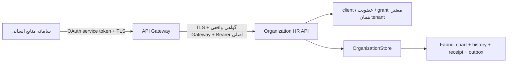

# اتصال سامانه منابع انسانی به چارت سازمانی فن‌آسا

تاریخ: ۱۲ اکتبر ۲۰۲۶. این راهنما همراه [مدل چارت، هویت و دسترسی](../ORGANIZATION-IDENTITY-ACCESS.md) است. سامانه HR از API نسخه‌دار همان میزبان Access Management و همان OrganizationStore/Fabric استفاده می‌کند. مرجع حساب ورود Keycloak مرکزی است؛ این اتصال حساب و گذرواژه مستقل یا رجیستری دوم ایجاد نمی‌کند.

## وضعیت پذیرش در ۱۳ اکتبر ۲۰۲۶

پیاده‌سازی محلی API و میزبانی **۱۷۱ بررسی موفق، صفر خطا و exit صفر** دارد؛ build بدون warning/error است. [شاهد محلی](hr-api-verification.json) و [لاگ](hr-api-test.log) آزمون‌های HTTPS/JWT/mTLS، مرز tenant، هر هفت عملیات، replay/conflict، بازخوانی history، بازگشایی store و rollback واقعی هنگام انقضای token/grant را ثبت می‌کنند. این شمار، سناریوهای تولیدی متمایز نیست. [تطبیق ماشینی قرارداد](hr-openapi-validation.log) YAML و JSON منتشرشده، ۱۸ مرجع محلی، سه مسیر، schemaهای Draft 2020-12 و نمونه‌های عدد/UUID/زمان را بررسی کرده؛ پذیرش کامل استاندارد OpenAPI از آن نتیجه نمی‌شود.

[بررسی مستقل فقط‌خواندنی VPS](hr-api-runtime-readonly.json) اتصال توسعه **Nginx → HTTPS/mTLS → API** را تأیید کرد: خواندن چارت با هویت سرویس موجود `200`، اتصال مستقیم بدون گواهی Gateway `403` و `/api/...` روی host عمومی توسعه `404` بود. نشانی عمومی توسعه همان `/development/organization-hr/v1` است. اتصال از loopback با حفظ hostname، SNI، Host و CA verification انجام شد، زیرا lookup محلی hostname خطا داشت؛ دسترسی DNS از رایانه مصرف‌کننده هنوز آزموده نیست. هیچ write، تغییر حساب یا grant در این بررسی انجام نشد و نتیجه محلی ۱۷۱ check به artifact مستقر نسبت داده نمی‌شود.

client موجود `fanasa-organization-hr-development` فقط برای tenant آزمایشی `hr-development` مجوز خواندن/نوشتن دارد؛ grant مشاهده‌شده تا `2026-10-19T14:35:12.5338158Z` معتبر است. حساب انسانی بررسی‌شده در `fanasa-internal` عضویت دارد، ولی آن سازمان برای همین service subject عضویت/grant ندارد. اتصال HR یک سازمان دیگر، ثبت و اجازه هویت سرویس همان سازمان را می‌خواهد؛ ایمیل کاربر جای service identity و tenant grant نیست.

پروفایل جدید APISIX در [بسته مالک گیت‌وی](/E:/SJVS/Projects/NeoCluster/fanasa-platform-workstreams/api-gateway/hr-integration/README.md) آماده و پیش‌فرض خاموش است. [شاهد مستقل مالک](/E:/SJVS/Projects/NeoCluster/fanasa-platform-workstreams/api-gateway/hr-integration/verification.json) **۳۶ آزمون موفق، ۲ آزمون اجرا نشده روی Windows و exit صفر** را ثبت می‌کند؛ native HR تأیید نشده و binding واقعی allocation/consumer-claim باز است. این شمار با ۱۹۳ آزمون عمومی Gateway جمع نمی‌شود. شاهد Nginx توسعه، پذیرش APISIX یا اتصال تجاری PDP/allocation نیست. binding نقش سازمانی به نقش محصول، provenance و reconciliation انتقال مراحل بعدی‌اند و API فعلی آن‌ها را خودکار انجام نمی‌دهد.

## مسیر اتصال و مرز اختیار



مصرف‌کننده، Bearer را برای audience محصول سازمان می‌گیرد. client خدماتی اختصاصی با client credentials و subject مستقلِ service account استفاده می‌شود؛ ورود انسان با همان client یا claim نقش ارسالی مشتری، اختیار این مسیر نیست. Gateway توکن اصلی را نگه می‌دارد و با گواهی client خود به upstream خصوصی TLS متصل می‌شود. backend گواهی peer واقعی را از اتصال TLS می‌خواند؛ `X-Forwarded-Client-Cert` یا header tenant/role جای این اتصال نیست.

محدوده خواندن و نوشتن مستقل است. client باید در رجیستری مرکزی محصول، فعال و مجاز به scope باشد؛ service subject نیز عضو فعال همان tenant و دارای grant مستقیم `organization.read` یا `organization.write` باشد. فعال‌سازی پیش‌فرض خاموش و تنظیمات ناقص بسته است. هیچ client، عضویت یا grant واقعی از داده نمونه این راهنما ایجاد نمی‌شود.

## API نسخه ۱

پایه مسیر backend خصوصی و پروفایل آماده APISIX:

```text
/api/organization-hr/v1/tenants/{tenantId}
```

در استقرار توسعه موجود، نشانی ثبت‌شده در metadata و OpenAPI منتشرشده `https://api.fanasa.net.local/development/organization-hr/v1` است و مسیرهای جدول با `/tenants/{tenantId}` به آن افزوده می‌شوند. ingress Nginx سه مسیر مجاز را صریحاً به `/api/organization-hr/v1/tenants/{tenantId}` روی upstream خصوصی HTTPS بازنویسی می‌کند؛ `auth_request` خصوصی، محدودیت نرخ موجود و بدنه ۶۴ KiB دارد. پروفایل جدید APISIX بدون rewrite از `/api/organization-hr/v1` استفاده می‌کند و هنوز پذیرش native HR ندارد. قرارداد JSON منتشرشده هر دو server را با وضعیت مستقل معرفی می‌کند.

| فراخوانی | کاربرد |
| --- | --- |
| `GET /chart` | خواندن نسخه جاری چارت؛ آرایه واحدها، سمت‌ها، نقش‌های سازمانی، انتصاب‌ها و revision. |
| `GET /history/{revision}` | دریافت snapshot یک revision متعهدشده برای تطبیق تغییرات و retry. |
| `POST /commands` | اجرای یک فرمان محدود با revision مورد انتظار و شناسه درخواست ثابت. |

قرارداد ماشین‌خوان در [OpenAPI پایلوت](hr-api.openapi.yaml) و [JSON منتشرشده](/E:/SJVS/Projects/Neo/products/Fanasa.AccessManagement/src/Fanasa.AccessManagement.Web/wwwroot/contracts/organization-hr-v1.openapi.json) نگهداری می‌شود. server توسعه با بررسی فقط‌خواندنی تأیید شده است؛ server پارامتری APISIX نمونه غیرفعال است و نشانی فعال‌شده تلقی نمی‌شود.

عملیات نسخه ۱: `role.save`، `unit.save`، `unit.archive`، `position.save`، `position.archive`، `appointment.add` و `appointment.end`. نقش این مجموعه `OrgRole` است؛ تغییر آن نقش نرم‌افزاری، permission یا grant ایجاد نمی‌کند. انتقال مستقیم `appointment.transfer` و جایگزینی کامل چارت مجاز نیستند؛ انتقال در طراحی از گردش تأیید و reconciliation اختیارات عبور می‌کند.

هر write باید `Idempotency-Key` یکتا و دقیقاً برابر UUID استاندارد `requestId` داشته باشد. `expectedRevision` از آخرین خواندن می‌آید. retry همان عملیات منطقی، همان receipt تاریخی را برمی‌گرداند؛ تغییر payload با همان شناسه conflict است. در conflict نسخه، HR چارت تازه را می‌خواند و تغییر را دوباره تطبیق می‌دهد؛ چارت موجود را با overwrite اجباری جایگزین نمی‌کند.

نمونه ایجاد واحد، صرفاً برای شکل payload:

```http
POST /api/organization-hr/v1/tenants/<tenant-uuid>/commands
Authorization: Bearer <service-access-token>
Content-Type: application/json
Idempotency-Key: 6a1b1591-5d04-4d66-bcf4-c72fc0906be2
```

```json
{
  "expectedRevision": 0,
  "operation": "unit.save",
  "id": null,
  "name": "واحد منابع انسانی",
  "code": "HR",
  "parentId": null,
  "kind": "department",
  "capacity": 0,
  "reason": "همگام‌سازی رویداد نمونه سامانه منابع انسانی",
  "requestId": "6a1b1591-5d04-4d66-bcf4-c72fc0906be2"
}
```

HR شناسه UUID واحد/سمت پذیرفته‌شده را از پاسخ چارت نگه می‌دارد و به شناسه رکورد خودش نگاشت می‌کند. `code` و کد پرسنلی کلید احراز هویت نیستند. برای انتصاب، `subject` باید به عضویت فعال همان سازمان وصل باشد؛ API حساب ورود یا عضویت تازه از روی نام/ایمیل نمی‌سازد. مدل جاری discriminator مستقل human/service ندارد؛ جلوگیری از انتصاب service subject پیکربندی‌شده، اثبات نوع همه حساب‌های دیگر نیست.

`expectedRevision` و `capacity` عدد صحیح JSON هستند؛ عدد داخل رشته پذیرفته نیست. ظرفیت فرمان بین صفر و ۱۰۰۰۰ و برای `position.save` حداقل یک است. زمان‌های `from/to` باید `YYYY-MM-DDTHH:mm:ss[.fraction]Z` یا offset صریح `±HH:mm` داشته باشند؛ `T/Z` بزرگ و بخش اعشاری، در صورت وجود، یک تا هفت رقم است. تاریخ و offset نامعتبر رد می‌شوند. `requestId`، تنها مقدار header `Idempotency-Key` و subject انتصاب UUID غیرصفر، با خط تیره و حروف کوچک هستند؛ subject انتصاب باید عضو فعال و متفاوت از service subject تنظیم‌شده باشد.

## کنترل و خطا

توکن امضاشده، issuer، audience، زمان، client و service subject بررسی می‌شوند. backend وضعیت tenant، client، scope، عضویت و grant را در هر فراخوانی، شامل retry، تازه می‌خواند. کنترل پیش و پس از mutation در تراکنش Fabric انجام می‌شود؛ لغو دسترسی یا انقضا نباید به نوشتن نیمه‌کاره منجر شود. payload محدود، فیلد ناشناخته/تکراری و عملیات ناشناخته رد می‌شوند. عامل audit از `sub` توکن معتبر می‌آید؛ actor ارسالی HR جای آن را نمی‌گیرد.

| status | رفتار HR |
| --- | --- |
| `200` | snapshot متعهدشده را ثبت و mapping محلی را تطبیق دهد. |
| `400` / `415` | schema، header و نوع محتوا را اصلاح کند؛ retry بی‌تغییر مفید نیست. |
| `401` | توکن معتبر و audience درست تهیه کند؛ secret در log قرار نگیرد. |
| `403` | trust Gateway، client/scope و مجوز tenant را بررسی کند؛ grant فرضی نسازد. |
| `404` | شناسه واحد، سمت، انتصاب یا revision با چارت مقصد تطبیق داده شود. |
| `409` | اختلاف revision یا payload تکراری را reconcile کند. |
| `413` | فرمان را به عملیات محدود و مستقل تقسیم کند. |
| `429` از Gateway | با backoff و همان شناسه عملیات retry کند؛ شناسه تازه برای دورزدن limit نسازد. |

در پروفایل metered، `unit.save` از مسیر HR بدون admission معتبر اجرا نمی‌شود. مسیر امن و متصل به قرارداد/مصرف موجود برای همین عملیات حفظ می‌شود؛ فعال‌بودن metering با خاموش‌کردن کنترل یا route تازه دور زده نمی‌شود. قرارگرفتن پشت Gateway به‌تنهایی، پذیرش تجاری سهمیه یا دفتر مصرف را اثبات نمی‌کند.

`application/json` لازم است؛ charset می‌تواند غایب باشد، ولی در صورت وجود فقط `utf-8` پذیرفته می‌شود. `Content-Encoding` باید غایب باشد. مسیر خصوصی `GET /gateway-access?operation=read|write` برای subrequest احراز اختیار Gateway است و در routeهای عمومی منتشر نمی‌شود. پاسخ `204` آن فقط هویت و اختیار tenant را تأیید می‌کند؛ فرمان اصلی subscription و سایر قواعد کسب‌وکار را مستقل می‌سنجد و این پاسخ، Permit تجاری یا admission مصرف نیست.

## تنظیمات و فعال‌سازی

`ReadScope` و `WriteScope` متفاوت و فاقد whitespace‌اند؛ issuer از HTTPS با مسیر `/realms/fanasa` و بدون userinfo، query یا fragment استفاده می‌کند. audience باید با محصول `organization-fabric` در رجیستری مرکزی برابر باشد. کلید اختیاری `Platform:CaFile` فقط اعتماد سفارشی backchannel دریافت metadata/JWKS از OIDC را تنظیم می‌کند؛ hostname و کاربرد `serverAuth` بررسی می‌شوند و سیاست فعلی زنجیره `RevocationMode=NoCheck` است. این گزینه جای pin گواهی Gateway نیست و trust store سیستم را تغییر نمی‌دهد.

کلیدهای `Organization:HrApi`: `Enabled`، `Authority`، `Audience`، `ClientId`، `ServiceSubject`، `ReadScope`، `WriteScope` و `GatewayCertificateSha256`. issuer باید HTTPS همان realm مرکزی پیکربندی‌شده باشد؛ service subject یک UUID واقعی همان client است. pin از گواهی واقعی upstream Gateway استخراج می‌شود. گواهی و private key از secret store موجود می‌آیند و در این سند یا مخزن ثبت نمی‌شوند.

Gateway باید فقط method/pathهای این API را route کند، اعتبار Bearer و scope مناسب را enforce کند، headerهای هویت/tenant/گواهی ارسالی مشتری را حذف کند، TLS upstream را validate کند و client certificate خود را بفرستد. backend listener خصوصی باید mTLS را درخواست کند. دسترسی مستقیم caller به backend، با Bearer درست و بدون گواهی Gateway هم رد می‌شود. timeout write نتیجه نامعلوم است؛ retry با همان `requestId` راه بازیابی نتیجه است.

میزبان از endpoint اختصاصی `Kestrel:Endpoints:OrganizationHr` استفاده می‌کند. در حالت فعال، نبود تنظیمات کامل یا URL غیرHTTPS راه‌اندازی را متوقف می‌کند. فقط همین listener گواهی client را درخواست می‌کند؛ listener انسانی تغییر نمی‌کند. pin برابر SHA-256 تمام گواهی DER است و گواهی باید زمان معتبر و EKU صریح `clientAuth` داشته باشد. نبود گواهی با `403` و گواهی نامعتبر در TLS رد می‌شود. تنظیم network/firewall و اعتبارسنجی گواهی server upstream در Gateway نیز شرط اتصال است؛ pin به‌تنهایی isolation شبکه را اثبات نمی‌کند.

[نمونه تنظیمات خاموش](hr-api.settings.example.json) فقط تنظیمات API را دارد و listener تازه راه‌اندازی نمی‌کند؛ مقدارهای جایگزین آن نباید فعال شوند. هنگام فعال‌سازی، endpoint خصوصی باید جدا در تنظیم Kestrel واقعی اضافه شود؛ تنظیم `Certificate:Path` و `Certificate:KeyPath` از mount معتبر می‌آید. URL مانند `https://127.0.0.1:9443` فقط وقتی Gateway در همان میزبان/namespace شبکه است کار می‌کند؛ در topology کانتینری، endpoint باید روی رابط خصوصی قابل دسترس همان شبکه bind شود و از بیرون منتشر نشود.

افزودن `Kestrel:Endpoints` جای listener تعریف‌شده با `ASPNETCORE_URLS` یا `--urls` را می‌گیرد. بنابراین تنظیم عملیاتی باید listener انسانی موجود را با همان نشانی/گواهی، به‌صورت named endpoint نیز حفظ کند و در کنار آن `OrganizationHr` را اضافه کند. صرف کپی‌کردن تنظیم port جدید، آزمون حفظ listener انسانی را نمی‌گذراند. گواهی placeholder در تنظیم Kestrel حتی با `HrApi.Enabled=false` ممکن است startup را خراب کند؛ به همین دلیل نمونه خاموش فاقد Kestrel است. [مرجع تنظیم endpoint در Kestrel](https://learn.microsoft.com/en-us/aspnet/core/fundamentals/servers/kestrel/endpoints?view=aspnetcore-10.0).

مرجع رفتار listener و service account: [Microsoft: certificate authentication](https://learn.microsoft.com/en-us/aspnet/core/security/authentication/certauth?view=aspnetcore-10.0)، [Kestrel named endpoint configuration](https://learn.microsoft.com/en-us/dotnet/api/microsoft.aspnetcore.server.kestrel.kestrelconfigurationloader.endpoint?view=aspnetcore-10.0)، و [Keycloak service accounts](https://www.keycloak.org/docs/latest/server_admin/index.html#_service_accounts).

پذیرش محلی backend با ۱۷۱ check و build موفق، و بررسی توسعه Nginx با GET مجاز `200` و اتصال مستقیم بدون گواهی `403` ثبت شده‌اند. بسته APISIX مالک Gateway، ۳۶ آزمون محلی موفق و ۲ skip روی Windows دارد؛ اجرای native HR و اتصال سازمان داخلی حساب انسانی هنوز پذیرفته نشده‌اند. قرارداد native قدیمیِ single-Gateway و آزمون‌های قبلی receiver، شاهد اجرای API جدید HR نیستند؛ هر محیط باید با route، گواهی، client و tenant همان محیط پذیرفته شود.
